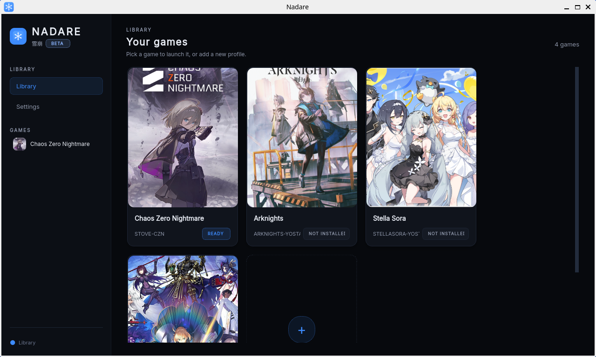
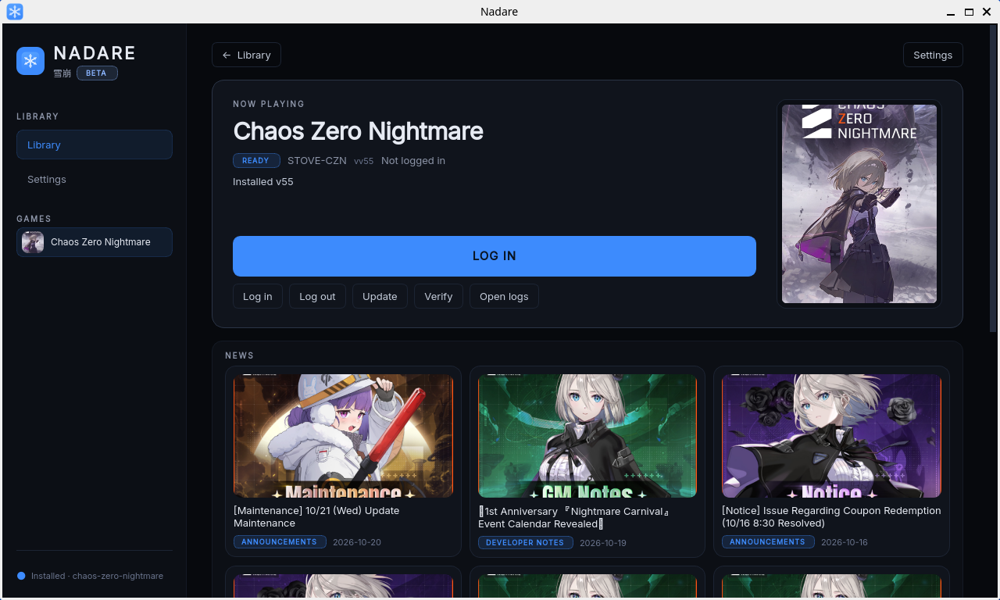
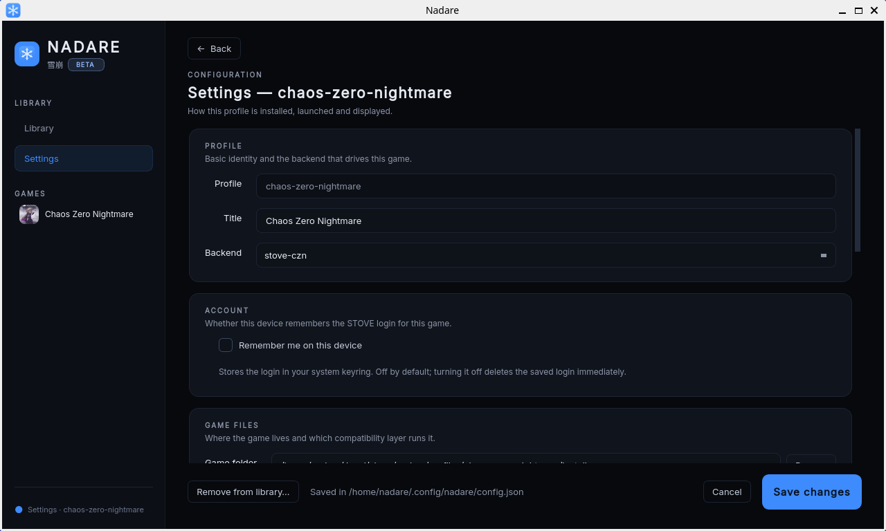

# Nadare

**A Linux launcher for anime gacha games.** Install, log in and play Chaos Zero
Nightmare, Arknights and Stella Sora from one window, with safe updates and one
profile per game.



> **Beta: expect bugs, and use at your own risk.** Nadare is unofficial
> community software, written largely with AI assistance (see
> [below](#built-with-ai-assistance)). It is **not affiliated with** any game
> publisher and stands in for their official launchers, which may break a game's
> Terms of Service and could get your account restricted. **Use an account you
> can afford to lose.** Read [Safety and ToS](#safety-and-tos) before you
> install, and please [report what you hit](CONTRIBUTING.md).

---

## Get started

**1. Check your system.** x86_64 Linux with glibc 2.35 or newer (Ubuntu 22.04+,
Debian 12+, Fedora 36+, current Arch/CachyOS, Mint 22). For Chaos Zero Nightmare
you need a working Vulkan driver with its 32-bit libraries (`vulkaninfo --summary`
should show your real GPU), about 15 GB free and, for *Remember me*, a Secret
Service keyring (GNOME Keyring or KWallet). Installing `umu-launcher` is
recommended, and on stock Debian/Ubuntu it is effectively required. Distro-specific
commands are in [docs/TESTERS.md](docs/TESTERS.md).

**2. Download and run.** Get `Nadare-<version>-x86_64.AppImage` from the
[Releases page](https://github.com/frostlinuxdev/nadare/releases) and check its
SHA-256 against the digest published there. Then just open it: most desktops let
you double-click an AppImage (if yours asks, allow it to run as a program in the
file's properties). From a terminal:

```sh
chmod +x Nadare-*-x86_64.AppImage
./Nadare-*-x86_64.AppImage
```

No FUSE (containers, some hardened systems)? Run it with
`./Nadare-*-x86_64.AppImage --appimage-extract-and-run`.

**3. Add a game.** Click **Add game**, pick *Chaos Zero Nightmare* and accept the
defaults. Log in by scanning the QR code **shown by your own Nadare window** with
the STOVE mobile app, click **Install**, then **Launch**.

**Updating:** download the new AppImage and replace the old one; the games update
themselves from inside Nadare. **Removing:** delete the AppImage and see
[Uninstall](#uninstall) for the data folders.

| Game page | Settings |
|---|---|
|  |  |

*Screenshots: the 0.1.0b1 AppImage on Fedora 44 (GNOME, Wayland). Game covers are
SteamGridDB grids by Sko514 (Chaos Zero Nightmare), The Sapper (Arknights) and
lazzxion (Fate/Grand Order); news thumbnails come from the publishers' own
feeds.*

## Supported games

| Game | Backend | Status |
|---|---|---|
| **Chaos Zero Nightmare** | `stove-czn` | First-class: install, update, QR login, launch on Proton. Tested on NVIDIA and AMD. |
| **Arknights** (EN, Yostar) | `arknights-yostar` | Install/update/launch through Proton; official launcher downloads are direct and verified. |
| **Stella Sora** (EN, Yostar) | `stellasora-yostar` | Install/update/launch through Proton. |
| **Fate/Grand Order (NA)** | `fgo-lepton` | **Experimental**: Android container (lepton-fgo); needs podman, a kernel with binderfs and an NVIDIA GPU. **Not installable in 0.1.0b2** (its lepton-fgo release is not in the public index yet); planned for a later beta. |
| Wine / Steam / script / Waydroid | generic | Scaffolding: you supply the prefix, exe or app. Not a supported product yet. |

Nadare is a beta: the first three are the tested paths (FGO is experimental,
the generic backends are scaffolding). See [PLAN.md](PLAN.md) for what is done
and what is left.

Nadare runs on the shoulders of projects that already work: it drives
**lepton-fgo** for FGO and the native STOVE/PCSDK path proven by **czn-linux**
for Chaos Zero Nightmare. It never reimplements a runtime it can call.

## Tested on

Chaos Zero Nightmare is proven in-game on **NVIDIA** + CachyOS (DW-Proton
11.0-14, the default runner, plus Proton-CachyOS and GE-Proton) and on **AMD**
(RX 7900 XTX, Debian 13, Mesa RADV, KDE Wayland: install, QR login and launch).
Intel GPUs are not verified yet. Other distros install and start (the AppImage
was smoke-tested on Ubuntu 22.04 and 24.04, Debian 12, Fedora 43 and 44, Arch and
Mint 22.1; those VM runs have no GPU).

## First launch (Chaos Zero Nightmare)

1. **Install** creates the game's Wine prefix, downloads the Proton runner
   (~320 MB), Microsoft's WebView2 runtime (~215 MB) and the STOVE client files
   (~270 MB).
2. **Log in** shows a QR code in the Nadare window; approve it in the STOVE mobile
   app. You log in once per profile.
3. **Launch** refreshes the game token, applies updates and starts the game. The
   game then downloads its own content (several GB) on first run.

**Remember me** (*Settings → Account*) keeps the STOVE login in your OS keyring
between runs. It is off by default and needs a Secret Service keyring; if it is
unavailable, `nadare doctor` prints the reason on its `keyring:` line. **Log out**
on the game page forgets the saved login.

Beta notes:

- STOVE keeps **one** valid login chain per account. Logging in on another
  machine or another profile invalidates this one; the app then asks you to log
  in again (its message currently says "log in first, or enable remember_me",
  even when remember me is on).
- The first launches stop at the game's own *Content Download … Confirm* prompt:
  the game fetches roughly 7.6 GB itself on first run. That is normal.
- Without a hardware Vulkan device (a VM, for example) the game cannot start;
  `nadare doctor` shows which Vulkan device Nadare sees.
- Fate/Grand Order does not install in this beta (see
  [Supported games](#supported-games)).

## Troubleshooting

Start with the log:
`~/.local/state/nadare/logs/nadare.log` (rotated, secrets masked).

Commands like `nadare doctor` or `nadare login -p <profile>` run as
`./Nadare-*.AppImage doctor` from the AppImage.

| Symptom | What to do |
|---|---|
| CZN `exit 2` / "cannot reach the update server" | Network or STOVE CDN issue. Retry; check DNS/proxy. Proxies come from the standard `HTTPS_PROXY`/`HTTP_PROXY` environment variables (there is no `proxy_url` setting). |
| CZN `exit 3` / "login expired" | Run `nadare login -p <profile>` and scan the QR again. |
| CZN `exit 6` / "no-connect" | The PCSDK handshake changed or the runner can't run the game. Try another runner (`"runner": "ge"`), or update Nadare. |
| CZN `exit 7` / "handshake-rejected" | The login session was retired. Log in again; make sure only one client is using the account. |
| CZN `exit 8` | The game is already running in this profile. Stop it first. |
| CZN `exit 9` | A runner download failed its checksum. Delete `~/.local/share/nadare/runners` and retry. |
| Arknights / Stella Sora freezes on the first frame (window drawn, CPU idle), native Wayland, NVIDIA | DXVK 3.1.1 (bundled with DW-Proton 11.0-14, Proton-CachyOS 20261005, GE-Proton11-9) can hang a game on its first present through its `VK_EXT_present_timing` path. Arknights sets `DXVK_CONFIG="dxvk.enablePresentTiming = False"` by default, so it is not affected; for another DXVK game add `"extra_env": {"DXVK_CONFIG": "dxvk.enablePresentTiming = False"}` to the profile, or pin a runner with DXVK 3.1 (DW-Proton 11.0-13, GE-Proton11-7, Proton-CachyOS 20260703). `"display": "x11"` also avoids it. The launch log line `runner: <build>, display: <driver>` shows what is in use. Do not point a profile at a moving `... Latest` runner directory: it can change under you. |
| Stella Sora: the gacha swipe (mouse drag) does nothing on Wayland | Wine's native Wayland driver does not deliver that drag; XWayland does. Stella Sora therefore defaults to XWayland (`PROTON_ENABLE_WAYLAND=0`). To go back to native Wayland set `"display": "wayland"` on the profile in `~/.config/nadare/config.json`; `"x11"` / `"auto"` keep XWayland. Arknights defaults to native Wayland. The launch log line `runner: <build>, display: <driver>` shows which is in use. |
| Stub build fails | Install `mingw-w64` (`gcc-mingw-w64-x86-64` / `mingw-w64-gcc`). |
| WebView2 install fails | Delete `~/.cache/nadare/czn/MicrosoftEdgeWebView2RuntimeInstallerX64.exe` and retry; the prefix must be writable. |
| FGO host check fails | Run `lepton-fgo`'s `check-host.sh` and install what it lists. |
| FGO + SELinux | Run the printed one-time `sudo .../setup-host-selinux.sh` as root, then retry. |
| "keyring unavailable" notice | Account logins are keyring-only. Install the `keyring` extra plus a Secret Service provider (gnome-keyring, KWallet) to enable **Remember me**; otherwise log in again each session — tokens are never written in plaintext. See [PRIVACY.md](PRIVACY.md). |

When reporting a problem, include Nadare version (`nadare --version`), distro,
kernel, GPU/driver, runtime stack versions, and a **redacted** log. Never attach
tokens or QR codes.

---

## Safety and ToS

- Nadare is **not affiliated with, endorsed by, or supported by** Smilegate,
  STOVE, Wellbia, TYPE-MOON, Aniplex, LASENGLE/Delightworks, Google, NVIDIA,
  Valve or any game publisher. Game names and trademarks belong to their owners.
- Nadare authenticates with **your own account** and hands the game a session
  from a non-official process. This can violate a game's Terms of Service.
  **Use an account you can afford to lose.**
- Nadare **does not touch, bypass or disable anti-cheat.** It is not a cheat and
  changes nothing inside the game.
- **No game files, credentials or provider secrets are shipped.** Games are
  downloaded from their official servers; tokens are minted from your own login.
- When it creates or launches a game prefix, Nadare replaces Wine's builtin
  Visual C++ runtime with Microsoft's official 2015-2022 x64 redistributable
  (downloaded from Microsoft and SHA-256-verified); this fixes stutter in some
  games and can be turned off per profile.
- **Only scan a QR code that your own Nadare window shows you.** Scanning
  someone else's QR code logs *them* into *your* account.
- **Get Nadare only from its official repository.** A modified copy could send
  your tokens to someone else. Release artifacts publish SHA-256 sums; verify
  them.
- Account recovery for FGO is done **inside the game** (My Room → Account
  Linking / Issue Transfer Number). Backing up local data does not protect your
  account on the server. Read lepton-fgo's own account-protection notes.

Never post tokens, QR codes, `session.json`, `secrets.json`, czn auth state or
full logs in an issue. See [SECURITY.md](SECURITY.md) and [PRIVACY.md](PRIVACY.md).

## Built with AI assistance

Nadare was written largely with AI coding assistants (Claude, plus smaller
models for routine edits), directed and reviewed by one maintainer. It has a test
suite and went through several rounds of correctness and security audits, but
real-world coverage is thin. Reviews and second opinions on the auth, keyring and
update code are especially welcome.

## Project documents

- [PLAN.md](PLAN.md) — roadmap to v0.1, what's done, open decisions.
- [PRIVACY.md](PRIVACY.md) — what is stored where; no telemetry.
- [SECURITY.md](SECURITY.md) — how to report, and what never to post.
- [CONTRIBUTING.md](CONTRIBUTING.md) — dev setup and the backend contract.
- [docs/BACKENDS.md](docs/BACKENDS.md) — how to add a game backend.
- [ARCHITECTURE.md](ARCHITECTURE.md) — internal design.

## License

Nadare is free software; the combined work is distributed under the **GNU General
Public License v3.0 only** (`GPL-3.0-only`), and the full text is in
[LICENSE](LICENSE). Every source file carries an SPDX header.

Copyright (C) 2026 Nadare contributors.

Most files say `GPL-3.0-or-later`, but that per-file grant cannot upgrade the
package: `src/nadare/backends/czn/auth.py` is **GPL-3.0-only**. It derives from
yporoc's ChaosZeroNightmareLauncher-Lite, which grants no "or later" clause, so
that single file cannot be relicensed. Keep its header intact if you touch it.
Packagers: use `License: GPL-3.0-only`. How the code was produced, and why the
project is GPLv3, is in [docs/AI.md](docs/AI.md).
See [ARCHITECTURE.md](ARCHITECTURE.md) and [CONTRIBUTING.md](CONTRIBUTING.md).

---

## Advanced: other install methods and building from source

Everything below is for packagers, developers and people who want to run Nadare
from a checkout. You do not need it to use the AppImage.

### System requirements (details)

**Host:** Linux x86_64, Python **3.12+**, a running Wayland or X11 session.

**For Chaos Zero Nightmare** you also need:

- A working Vulkan driver (NVIDIA, or Mesa for AMD/Intel) plus its 32-bit
  libraries, and a Secret Service keyring (GNOME Keyring or KWallet).
- Nothing else: Nadare downloads its own Proton runner, ships the PCSDK stub
  prebuilt, and runs Proton directly. `umu-launcher` is optional (used if
  found) and `mingw-w64` is only needed to rebuild the stub from source.

**For Fate/Grand Order (NA)** the heavy lifting is in **lepton-fgo**;
its `lepton/check-host.sh`
reports the exact list. In short: a live Wayland session, `podman` with the
`crun` runtime, binderfs, `~30 GiB` free, and an NVIDIA (proprietary/Vulkan) or
Mesa GPU. Nadare downloads a pinned, sha256-checked `lepton-fgo` release on the
first install, unless you point the profile (or `$LEPTON_FGO_REPO`) at your own
checkout. FGO support is **experimental** (tested on NVIDIA + CachyOS only) and the
install step does not work in 0.1.0b2: the public index does not carry the
`lepton-fgo` release yet. It is planned for a later beta.

### Install system packages (source installs)

The AppImage and Flatpak need none of this for CZN. These packages are for
running Nadare from source; `umu-launcher` is optional (used when present) and
`mingw-w64` is only needed to rebuild the PCSDK stub.

**Arch / CachyOS / Manjaro**
```sh
sudo pacman -S --needed python git curl umu-launcher mingw-w64-gcc
```
(`umu-launcher` lives in `multilib`; enable it in `/etc/pacman.conf` if needed.)

**Fedora**
```sh
sudo dnf install python3 git curl umu-launcher mingw64-gcc
```

**Debian / Ubuntu**
```sh
sudo dpkg --add-architecture i386 && sudo apt update
sudo apt install python3 python3-venv git curl gcc-mingw-w64-x86-64
```
Then install `umu-launcher` from its
[releases](https://github.com/Open-Wine-Components/umu-launcher/releases). It
ships as two `.deb`s for your release; install both at once:
```sh
sudo apt install ./umu-launcher_*.deb ./python3-umu-launcher_*.deb
```
The i386 step is required by umu's 32-bit graphics libraries.

### Flatpak (beta)

The beta is published as an **AppImage only**; the Flatpak is not released yet.
You can build it from source (`packaging/flatpak`) and install the bundle:

```sh
flatpak install --user Nadare-*.flatpak
flatpak run io.github.frostlinuxdev.Nadare        # or use the menu entry
```

Notes for the beta:

- Proton runs **inside** the sandbox with the Flatpak runtime's GPU drivers. On
  NVIDIA the `org.freedesktop.Platform.GL.nvidia-<version>` extension must match
  your host driver; `flatpak update` installs it. `nadare doctor` (run it with
  `flatpak run io.github.frostlinuxdev.Nadare doctor`) shows the Vulkan device
  it sees.
- The bundle has no auto-update yet: install the new `.flatpak` to update.
- Use the GUI to stop a game. A separate `flatpak run … stop` cannot see a game
  started by another `flatpak run` (each run gets its own process namespace).
- FGO (Experimental) inside the Flatpak is untested.

A `.deb` is not published yet; use the AppImage or build from source.

### Running from source

```sh
git clone https://github.com/frostlinuxdev/nadare.git
cd nadare

# 1. Python environment
python3 -m venv .venv
.venv/bin/pip install --upgrade pip
.venv/bin/pip install -r requirements.txt
.venv/bin/pip install -e .          # provides the `nadare` command

# 2. Sanity check
.venv/bin/nadare --version
```

If you would rather not install the project, every command below also works as
`.venv/bin/python -m nadare ...`.

#### Configure a profile

Nadare is profile-based. In the GUI use **Add game** (or the **+** card in the
library). For the CLI there is no profile editor yet, so create
`~/.config/nadare/config.json` by hand once:

**Chaos Zero Nightmare** (installs under Nadare's own data directory; the
`dwproton` runner, the tested DW-Proton 11.0-14 release, is downloaded and
checksum-verified on first install; `"cachyos"` and `"ge"` are alternatives):
```json
{
  "schema": 1,
  "active_profile": "czn",
  "profiles": {
    "czn": {
      "backend": "stove-czn",
      "title": "Chaos Zero Nightmare",
      "runner": "dwproton"
    }
  }
}
```

**Fate/Grand Order (NA)** (point `repo` at your `lepton-fgo` checkout; see its
README to install the stack first):
```json
{
  "schema": 1,
  "active_profile": "fgo",
  "profiles": {
    "fgo": {
      "backend": "fgo-lepton",
      "title": "Fate/Grand Order (NA)",
      "context": "fgo",
      "repo": "~/lepton-fgo",
      "mode": "strict",
      "accept_account_notice": true
    }
  }
}
```

`accept_account_notice` records that you have read lepton-fgo's account-recovery
notice. The FGO installer refuses to skip it by design; unattended installs must
set it.

#### Run

The GUI is the main way to use Nadare; the CLI is there for scripting and
diagnostics (`nadare doctor` is the first thing to run when something is off):

```sh
.venv/bin/nadare list                  # show profiles
.venv/bin/nadare status -p czn         # or -p fgo
.venv/bin/nadare install -p czn        # first-time setup + download
.venv/bin/nadare login   -p czn        # QR login for STOVE (CZN)
.venv/bin/nadare launch  -p czn        # renew token + update + play
.venv/bin/nadare stop    -p czn
.venv/bin/nadare verify  -p czn
```

> **CLI note:** `login` and `launch` are separate processes, so the in-memory
> session from `login` does not carry over. To use the CLI, set
> `"remember_me": true` on the profile and have a working OS keyring, so
> `launch` can restore the saved session. Otherwise `nadare launch` exits `3`
> with `log in first, or enable remember_me`. The GUI keeps the session for
> the lifetime of the window, so remember-me is optional there.

Add `-q` to suppress log lines and keep progress, or `-v` for debug logging.

From a source checkout the GUI starts with:

```sh
./scripts/dev.sh gui
```

`scripts/dev.sh gui` starts the window directly; `nadare gui` runs the same
entry point (`app.run_gui` → `nadare.gui.run`).

Source-install notes: if `nadare` is not found use `.venv/bin/nadare` (or
`.venv/bin/python -m nadare`); if the GUI fails to start install the extras with
`.venv/bin/pip install -e ".[dev]"` (PyQt6 must load on your display server).

### Updating

**Source checkout**
```sh
cd nadare
git pull
.venv/bin/pip install -r requirements.txt
.venv/bin/pip install -e .
```
The CZN PCSDK stub is rebuilt automatically when missing; force a rebuild with
`rm -rf ~/.local/share/nadare/profiles/*/stub` before the next install/launch.

**Downloaded package** (AppImage / `.deb`): download the new artifact and
replace the old one. Nadare's update journal makes game updates crash-safe, but
it does not update Nadare itself.

FGO's runtime stack is updated by `lepton-fgo update`; Nadare calls it as part of
the backend's `update`.

### Uninstall

**From source:** delete the checkout and its venv. Then remove Nadare's data
(nadare never writes outside XDG directories):

```sh
rm -rf ~/.local/share/nadare \
       ~/.config/nadare \
       ~/.local/state/nadare \
       ~/.cache/nadare
```

**Downloaded package:** remove the AppImage, or `sudo apt remove nadare` for the
`.deb`, then run the data removal above.

**Stored tokens:** account (CZN) logins live only in the keyring. Remove the
`nadare-launcher` service entries:
```sh
secret-tool clear service nadare-launcher token:czn   # one per profile
```
or delete them in Seahorse / KWallet. Non-account secrets may use the plaintext
fallback at `~/.config/nadare/secrets.json` when no keyring is present; delete
that file too if it exists.

**FGO's own data** (context, APKs, assets) is managed by lepton-fgo:
`lepton-fgo uninstall fgo [--purge]`. The game's `--purge` is explicit for a
reason — read its warning first.

From a checkout, `nadare remove` drops a profile from the library (its shortcuts
and config entry) and keeps the game files unless you ask otherwise:

```sh
nadare remove -p czn --yes                        # profile + shortcuts only
nadare remove -p czn --delete-data --yes          # also the profile's data folder
nadare remove -p czn --delete-install-dir --delete-prefix --yes
```

`--delete-data`, `--delete-install-dir` and `--delete-prefix` are each opt-in
(directories shared with another profile or outside Nadare's own folders are
refused); `--yes` is required to confirm. The GUI exposes the same action.
