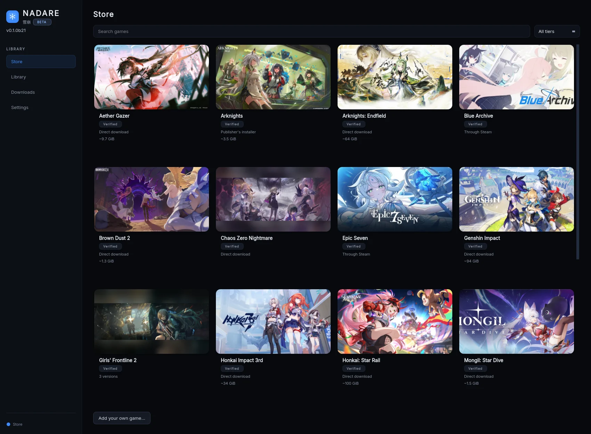
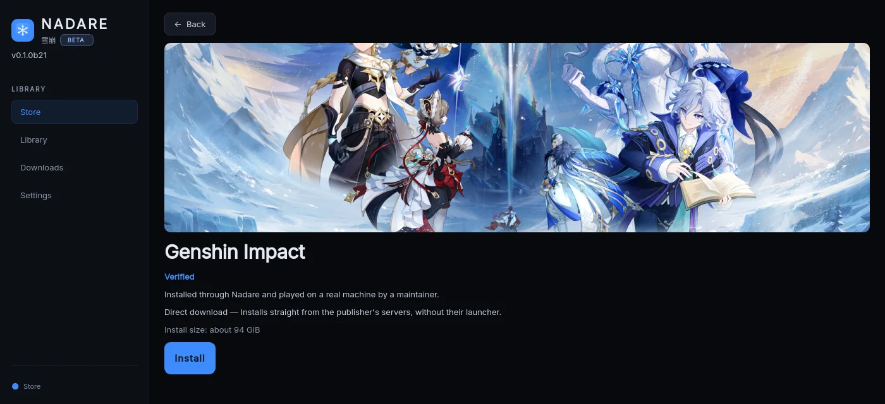
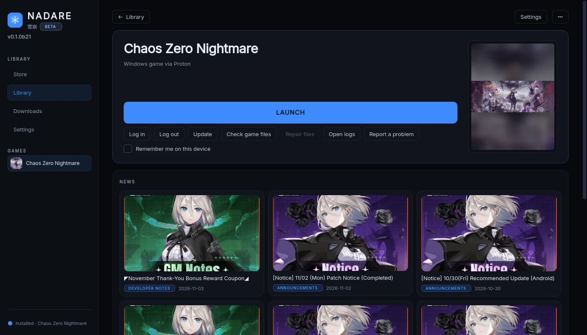

# Nadare Launcher

**Nadare is an open-source Linux launcher for anime games**: Genshin Impact, Honkai: Star
Rail, Zenless Zone Zero, Wuthering Waves, Arknights: Endfield, Punishing: Gray Raven,
NIKKE, Brown Dust 2, Chaos Zero Nightmare and more. Pick a game in the Store, press
Install, press Play. Nadare downloads the game from the publisher, sets up the Wine/Proton
environment, and keeps it updated, one profile per game.

> **⬇ Download:** [nadare.app/download](https://nadare.app/download/), or follow
> [Get started](#get-started) below. The **Flatpak** is the easiest way: your software centre
> installs it and keeps it updated.

Source code and the issue tracker are at
[github.com/frostlinuxdev/nadare](https://github.com/frostlinuxdev/nadare).

## Get started

### 1. Install Nadare

Nadare comes in **two separate forms. Pick one, not both:**

| | **Option A: Flatpak** (recommended) | **Option B: AppImage** |
|---|---|---|
| What it is | Installed by your software centre | One portable file you run directly |
| Updates | Through your software centre | Nadare updates the file itself |

#### Option A: Flatpak

From our own signed repository at `https://flatpak.nadare.app/` (not Flathub yet).

- Download **[nadare.flatpakref](https://flatpak.nadare.app/nadare.flatpakref)** and open it.
  Linux Mint's Software Manager, GNOME Software and KDE Discover install Nadare from there.
- **Bazzite (Bazaar), or if that file does not open:** download
  **[nadare.flatpak](https://flatpak.nadare.app/nadare.flatpak)** and open it instead. (Same
  Flatpak, different way in: you need only one of these two files. Updates still come from our
  repository.)
- Terminal: `flatpak install --user https://flatpak.nadare.app/nadare.flatpakref`

Then start **Nadare** from your app menu. If a banner says a 32-bit graphics package or system
libraries are missing, press **Install** on it.

#### Option B: AppImage

From the
[latest release](https://github.com/frostlinuxdev/nadare/releases/latest), under **Assets**,
download **`Nadare-<version>-x86_64.AppImage`** (not the "Source code" zips). Linux does not
let a downloaded file run yet, so double-clicking it does nothing at first. Pick one:

- **No terminal:** right-click the file → **Properties** → **Permissions** → tick
  **Allow executing file as program**, then double-click it. Or open it with
  [Gear Lever](https://flathub.org/apps/it.mijorus.gearlever), which also adds Nadare to your
  app menu.
- **Terminal:**

  ```sh
  cd ~/Downloads && chmod +x Nadare-*-x86_64.AppImage && ./Nadare-*-x86_64.AppImage
  ```

  Without FUSE (containers, some hardened systems), add `--appimage-extract-and-run`.

To check the file is ours, see
[Check the download](docs/INSTALL.md#check-the-download-optional).

Step by step, with pictures: [docs/INSTALL.md](docs/INSTALL.md).

### 2. Install a game

Nadare opens on the **Store**. Pick a game, choose an install folder and press **Install**.
Games that need a login ask for it on their page.

### 3. Play

Press **Play** on the game's page.



> **Beta: expect bugs.** Installs, updates, logins and the GUI can break. Keep your own
> backups and [report what you hit](#report-a-bug).

> **Unofficial, use at your own risk.** Nadare is community software and is **not
> affiliated with, endorsed by, or supported by** any game publisher. It stands in for
> official launchers when talking to game servers, which may break a game's Terms of
> Service and could get your account restricted. Read [Safety and ToS](#safety-and-tos)
> before you install.

## What you need

You need a Linux x86_64 desktop (Wayland or X11) with `glibc` 2.35 or newer (Ubuntu 22.04+,
Debian 12+, Fedora 36+, current Arch) and a working Vulkan driver (NVIDIA, or Mesa for
AMD/Intel) **including its 32-bit Vulkan support**. Nothing else is needed on most systems:
Nadare downloads its own Proton runner and runs every game in the Steam Runtime, which
brings the other 32-bit libraries (FreeType, udev and so on) with it. The first game you
start downloads that runtime once (a few hundred MB). On Ubuntu 24.04 and newer, Nadare
asks once for a permission the runtime needs (one password prompt). The AppImage
bundles the GL loader and the Qt X11 platform libraries it needs. A Secret Service
keyring (GNOME Keyring or KWallet) is optional and only used for *Remember me*.

With the Flatpak, the `glibc` version does not matter (it brings its own runtime from Flathub);
you still need a working GPU driver. There are no `.deb` or RPM packages.

New here? Read the [tester guide](docs/TESTERS.md). Something wrong? Run
`flatpak run io.github.frostlinuxdev.Nadare doctor` (Flatpak) or `./Nadare-*.AppImage doctor`
(AppImage) and see [Troubleshooting](docs/TROUBLESHOOTING.md).

Tested on NVIDIA + CachyOS and on AMD (RX 7900 XTX, Mesa, Debian 13), and the AppImage
starts from the command above on Ubuntu 22.04 and 24.04, Debian 12, Fedora 44, Arch and Mint 22.1. Real game runs on
Intel GPUs are not verified yet.

---

## Supported games

Every game has a tier, shown on its Store card. **Verified** means a maintainer installed
it through Nadare and played it past the title screen. **Experimental** means the install
is covered by tests but has not been played end to end, or needs a workaround.





| Game | Tier |
|---|---|
| Chaos Zero Nightmare | Verified (install, update, QR login including two-step (OTP) accounts, agreeing to the game's terms, launch) |
| Arknights, Stella Sora | Verified |
| Brown Dust 2, Aether Gazer, Punishing: Gray Raven | Verified |
| Girls' Frontline 2 (Darkwinter build and Haoplay global build), Honkai Impact 3rd | Verified |
| Genshin Impact, Honkai: Star Rail, Zenless Zone Zero | Verified |
| Wuthering Waves, NIKKE | Verified |
| Arknights: Endfield, Neverness to Everness (direct install), Mongil: Star Dive | Verified |
| Epic Seven, Umamusume: Pretty Derby, Blue Archive | Verified (installed through Steam) |
| Snowbreak: Containment Zone, Duet Night Abyss | Experimental (direct download) |
| Reverse: 1999, Tower of Fantasy, Blue Protocol: Star Resonance (global) | Experimental (direct download) |
| Heaven Burns Red (EN), Azur Promilia (JP, optional community English patch) | Experimental (direct download through the Yostar platform) |
| Fate/Grand Order (NA) | Experimental, source checkouts only, needs podman and an NVIDIA GPU |

How the catalog works, and how to add a game, is in [docs/CATALOG.md](docs/CATALOG.md).

---

## Safety and ToS

- Nadare is **not affiliated** with any publisher. Game names and trademarks belong to
  their owners.
- Nadare signs in with **your own account** and hands the game a session from a
  non-official process. This can violate a game's Terms of Service. **Use an account you
  can afford to lose.**
- Nadare **does not touch, bypass or disable anti-cheat.** It is not a cheat and changes
  nothing inside the game.
- Games run in a **Sandbox** by default that hides your home folder, other drives and your
  keyring from them. You can turn it off per game on its page.
- **No game files, credentials or provider secrets are shipped.** Games come from the
  publishers' own servers, and tokens are minted from your own login.
- Nadare installs Microsoft's official Visual C++ 2015-2022 runtime (downloaded from
  Microsoft, SHA-256-verified) into game prefixes; it is best-effort and never blocks an
  install.
- **Only scan a QR code that your own Nadare window shows you.** Scanning someone else's
  QR code logs *them* into *your* account.
- **Get Nadare only from its official repository** and verify the published SHA-256 sums.
  A modified copy could send your tokens to someone else.

Never post tokens, QR codes, `session.json`, `secrets.json` or full logs in an issue. See
[SECURITY.md](SECURITY.md), [PRIVACY.md](PRIVACY.md) and
[docs/ACCOUNT-SAFETY.md](docs/ACCOUNT-SAFETY.md).

---

## Command line

The GUI is the product. The command line is plumbing beside it — what shortcuts and
scripts call, plus diagnostics — not a second front end:

In the Flatpak, use `flatpak run io.github.frostlinuxdev.Nadare <command>` instead of
`Nadare-*.AppImage <command>`.

```sh
Nadare-*.AppImage launch -p <profile>  # what every desktop and Steam shortcut runs
Nadare-*.AppImage doctor               # check this machine
Nadare-*.AppImage report               # build a redacted support report
Nadare-*.AppImage list                 # profiles
Nadare-*.AppImage status -p <profile>
```

`install`, `update`, `repair`, `stop` and `verify` work the same way for unattended
runs. Other commands (cover art, the Flatpak move, rebuilding a prefix) still exist
for support cases; `nadare --help` names them on its Advanced line.

From a source checkout, use `.venv/bin/nadare` instead. See
[docs/SOURCE-INSTALL.md](docs/SOURCE-INSTALL.md) for running from source, profiles by hand,
and Fate/Grand Order.

## Updating and uninstalling

**Flatpak:** your software centre (or `flatpak update`) updates Nadare like any other app.
Already using the AppImage? Settings → **Move to the Flatpak…** moves your games and settings once.

**AppImage:** Nadare tells you when a new release is out. When it runs from a folder you can
write to, the banner says **Update**: Nadare downloads the new AppImage, checks it against a
checksum from the Nadare index and against the release signature, keeps your old copy as
`*.previous`, and asks before restarting. Otherwise, download the new AppImage and replace the old one. To remove Nadare and
its data, see [Uninstall](docs/TROUBLESHOOTING.md#uninstall).

## Report a bug

Open an issue at
[github.com/frostlinuxdev/nadare/issues](https://github.com/frostlinuxdev/nadare/issues)
(one problem per issue) and attach a report: on the game's page press **Report a problem**.
Nadare collects the version, your system, GPU and driver, `doctor` and the game's recent
logs, with tokens masked and your home folder shown as `~`. Read it, then use **Copy to clipboard** or
**Save as file…**. From a terminal: `./Nadare-*.AppImage report > report.txt`. Say what you
pressed and what you expected. Never attach tokens, QR codes or full auth traffic.

---

## Project documents

- [docs/TESTERS.md](docs/TESTERS.md): the tester guide.
- [docs/TROUBLESHOOTING.md](docs/TROUBLESHOOTING.md): fixes for common problems, and uninstalling.
- [docs/SOURCE-INSTALL.md](docs/SOURCE-INSTALL.md): running from source, FGO, requirements per game.
- [docs/CATALOG.md](docs/CATALOG.md): the game catalog and its tiers.
- [docs/BACKENDS.md](docs/BACKENDS.md): how to add a game backend.
- [PLAN.md](PLAN.md): roadmap and open decisions.
- [ARCHITECTURE.md](ARCHITECTURE.md) and [CONTRIBUTING.md](CONTRIBUTING.md): internals and dev setup.
- [PRIVACY.md](PRIVACY.md) and [SECURITY.md](SECURITY.md).

## License

Nadare is free software, distributed under the **GNU General Public License v3.0 only**
(`GPL-3.0-only`); the full text is in [LICENSE](LICENSE). Most source files carry an
SPDX header. Most say `GPL-3.0-or-later`, but `src/nadare/backends/czn/auth.py` is
**GPL-3.0-only** because it derives from a project that grants no "or later" clause, so
keep its header intact. Packagers: use `License: GPL-3.0-only`. How the code was produced,
and why the project is GPLv3, is in [docs/AI.md](docs/AI.md).

Copyright (C) 2026 Nadare contributors.

Nadare builds on projects that already work: it drives **lepton-fgo** for FGO and uses the
native STOVE/PCSDK path proven by **czn-linux** for Chaos Zero Nightmare.
