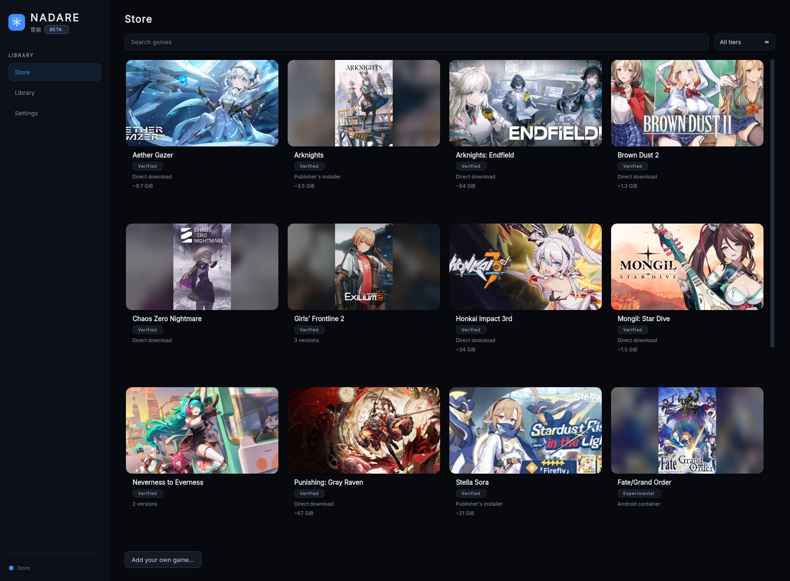
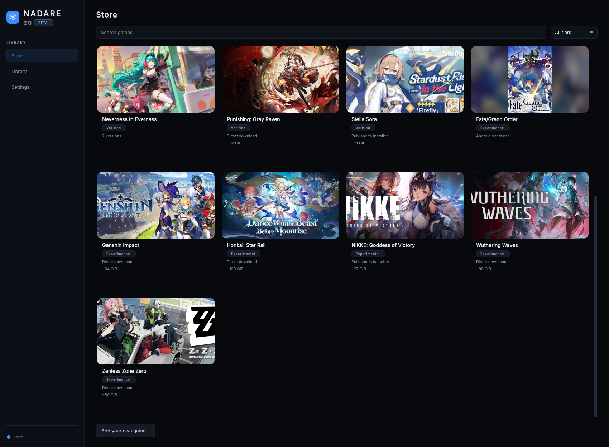

# Nadare Launcher

**Nadare is an open-source Linux launcher for anime games**: Genshin Impact, Honkai: Star
Rail, Zenless Zone Zero, Wuthering Waves, Arknights: Endfield, Punishing: Gray Raven,
NIKKE, Brown Dust 2, Chaos Zero Nightmare and more. Pick a game in the Store, press
Install, press Play. Nadare downloads the game from the publisher, sets up the Wine/Proton
environment, and keeps it updated, one profile per game.





**Download:** the latest AppImage is on the
[releases page](https://github.com/frostlinuxdev/nadare/releases). Source code and the
issue tracker are at [github.com/frostlinuxdev/nadare](https://github.com/frostlinuxdev/nadare).

> **Beta: expect bugs.** Installs, updates, logins and the GUI can break. Keep your own
> backups and [report what you hit](#report-a-bug).

> **Unofficial, use at your own risk.** Nadare is community software and is **not
> affiliated with, endorsed by, or supported by** any game publisher. It stands in for
> official launchers when talking to game servers, which may break a game's Terms of
> Service and could get your account restricted. Read [Safety and ToS](#safety-and-tos)
> before you install.

---

## Get started

1. Download `Nadare-<version>-x86_64.AppImage` from the releases page and check its
   SHA-256 against the sum published there.
2. Make it executable and run it:

   ```sh
   chmod +x Nadare-*-x86_64.AppImage
   ./Nadare-*-x86_64.AppImage
   ```

   Without FUSE (containers, some hardened systems), add `--appimage-extract-and-run`.
3. Open the **Store** (first item in the sidebar), pick a game, choose an install folder,
   and press **Install**. Games that need a login ask for it on their page.

You need a Linux x86_64 desktop (Wayland or X11) with `glibc` 2.35 or newer (Ubuntu 22.04+,
Debian 12+, Fedora 36+, current Arch) and a working Vulkan driver (NVIDIA, or Mesa for
AMD/Intel) **including its 32-bit Vulkan support**. Nothing else is needed on most systems:
Nadare downloads its own Proton runner, and the runtime it uses brings the other 32-bit
libraries (FreeType, udev and so on) with it. If your system cannot use that runtime,
`doctor` prints a `32-bit libs:` line and the command that fixes it. The AppImage
bundles the GL loader and the Qt X11 platform libraries it needs. A Secret Service
keyring (GNOME Keyring or KWallet) is optional and only used for *Remember me*.

There is no Flatpak or `.deb` yet; the AppImage is the only release.

New here? Read the [tester guide](docs/TESTERS.md). Something wrong?
Run `./Nadare-*.AppImage doctor` and see [Troubleshooting](docs/TROUBLESHOOTING.md).

Tested on NVIDIA + CachyOS and on AMD (RX 7900 XTX, Mesa, Debian 13), and the AppImage
starts on Ubuntu 22.04, Debian 12, Fedora 43, Arch and Mint 22.1. Real game runs on Intel
GPUs are not verified yet.

---

## Supported games

Every game has a tier, shown on its Store card. **Verified** means a maintainer installed
it through Nadare and played it past the title screen. **Experimental** means the install
is covered by tests but has not been played end to end, or needs a workaround.

| Game | Tier |
|---|---|
| Chaos Zero Nightmare | Verified (install, update, QR login, launch) |
| Arknights, Stella Sora | Verified |
| Brown Dust 2, Aether Gazer, Punishing: Gray Raven | Verified |
| Girls' Frontline 2 (Darkwinter build), Honkai Impact 3rd | Verified |
| Arknights: Endfield, Neverness to Everness (direct install), Mongil: Star Dive | Verified |
| Genshin Impact, Honkai: Star Rail, Zenless Zone Zero | Experimental (checked as far as the login screen) |
| Wuthering Waves, NIKKE | Experimental |
| Girls' Frontline 2 (Haoplay global build), Neverness to Everness (publisher's launcher) | Experimental |
| Fate/Grand Order (NA) | Experimental, source checkouts only, needs podman and an NVIDIA GPU |

How the catalog works, and how to add a game, is in [docs/CATALOG.md](docs/CATALOG.md).

---

## Safety and ToS

- Nadare is **not affiliated** with any publisher. Game names and trademarks belong to
  their owners.
- Nadare signs in with **your own account** and hands the game a session from a
  non-official process. This can violate a game's Terms of Service. **Use an account you
  can afford to lose.**
- Nadare **does not touch, bypass or disable anti-cheat.** It is not a cheat and changes
  nothing inside the game.
- **No game files, credentials or provider secrets are shipped.** Games come from the
  publishers' own servers, and tokens are minted from your own login.
- Nadare installs Microsoft's official Visual C++ 2015-2022 runtime (downloaded from
  Microsoft, SHA-256-verified) into game prefixes; it is best-effort and never blocks an
  install.
- **Only scan a QR code that your own Nadare window shows you.** Scanning someone else's
  QR code logs *them* into *your* account.
- **Get Nadare only from its official repository** and verify the published SHA-256 sums.
  A modified copy could send your tokens to someone else.

Never post tokens, QR codes, `session.json`, `secrets.json` or full logs in an issue. See
[SECURITY.md](SECURITY.md), [PRIVACY.md](PRIVACY.md) and
[docs/ACCOUNT-SAFETY.md](docs/ACCOUNT-SAFETY.md).

---

## Command line

The GUI is the main way to use Nadare; the same actions exist on the command line:

```sh
Nadare-*.AppImage list                 # profiles
Nadare-*.AppImage status -p <profile>
Nadare-*.AppImage install -p <profile>
Nadare-*.AppImage launch  -p <profile>
Nadare-*.AppImage doctor               # check this machine
```

From a source checkout, use `.venv/bin/nadare` instead. See
[docs/SOURCE-INSTALL.md](docs/SOURCE-INSTALL.md) for running from source, profiles by hand,
and Fate/Grand Order.

## Updating and uninstalling

Nadare tells you when a new release is out; download the new AppImage and replace the old one (it does not replace itself). To
remove Nadare and its data, see [Uninstall](docs/TROUBLESHOOTING.md#uninstall).

## Report a bug

Open an issue at
[github.com/frostlinuxdev/nadare/issues](https://github.com/frostlinuxdev/nadare/issues)
(one problem per issue). Include the Nadare version, how you installed it, your distro,
kernel, GPU and driver, desktop (KDE/GNOME, Wayland/X11), and the **redacted** log from
*Open logs*, plus the output of `doctor`. Never attach tokens, QR codes or full auth traffic.

---

## Project documents

- [docs/TESTERS.md](docs/TESTERS.md): the tester guide.
- [docs/TROUBLESHOOTING.md](docs/TROUBLESHOOTING.md): fixes for common problems, and uninstalling.
- [docs/SOURCE-INSTALL.md](docs/SOURCE-INSTALL.md): running from source, FGO, requirements per game.
- [docs/CATALOG.md](docs/CATALOG.md): the game catalog and its tiers.
- [docs/BACKENDS.md](docs/BACKENDS.md): how to add a game backend.
- [PLAN.md](PLAN.md): roadmap and open decisions.
- [ARCHITECTURE.md](ARCHITECTURE.md) and [CONTRIBUTING.md](CONTRIBUTING.md): internals and dev setup.
- [PRIVACY.md](PRIVACY.md) and [SECURITY.md](SECURITY.md).

## License

Nadare is free software, distributed under the **GNU General Public License v3.0 only**
(`GPL-3.0-only`); the full text is in [LICENSE](LICENSE). Every source file carries an
SPDX header. Most say `GPL-3.0-or-later`, but `src/nadare/backends/czn/auth.py` is
**GPL-3.0-only** because it derives from a project that grants no "or later" clause, so
keep its header intact. Packagers: use `License: GPL-3.0-only`. How the code was produced,
and why the project is GPLv3, is in [docs/AI.md](docs/AI.md).

Copyright (C) 2026 Nadare contributors.

Nadare builds on projects that already work: it drives **lepton-fgo** for FGO and uses the
native STOVE/PCSDK path proven by **czn-linux** for Chaos Zero Nightmare.
