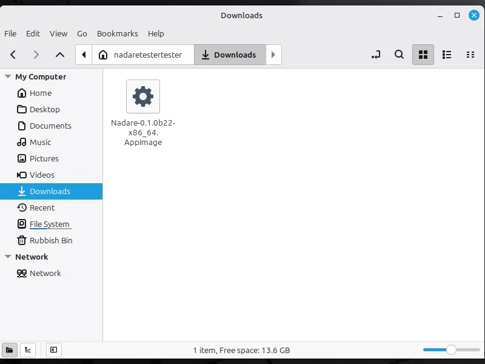
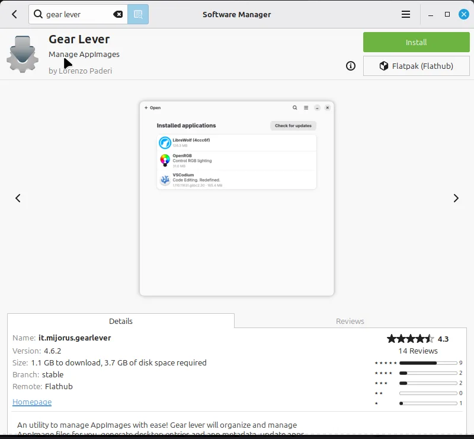
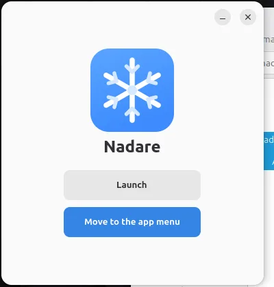
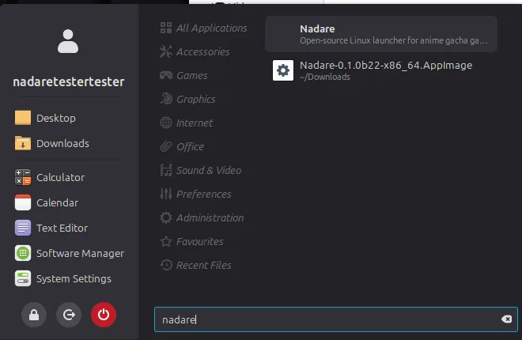
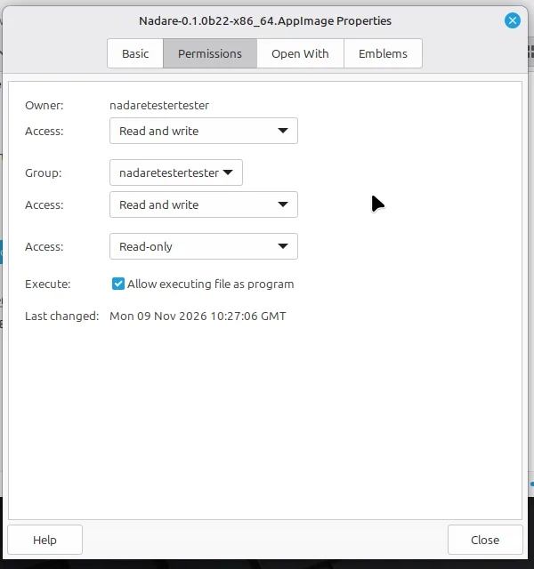
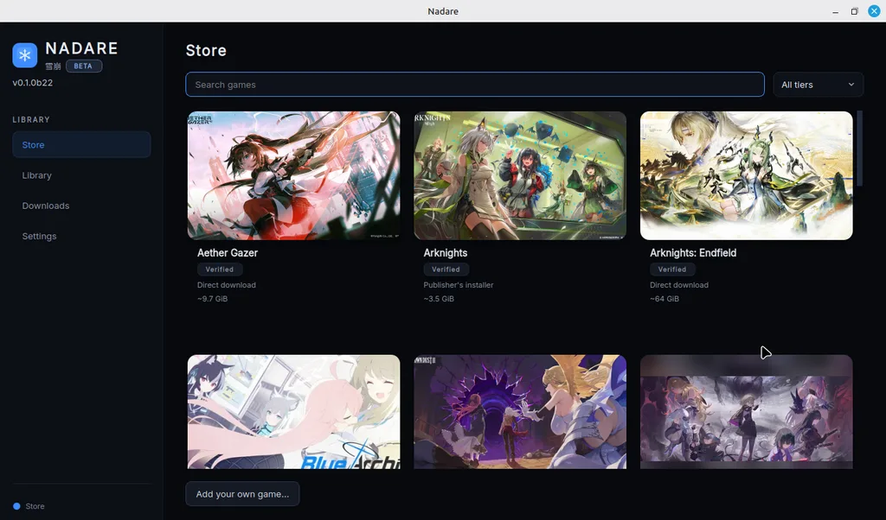

# Install Nadare

Nadare is one file, an AppImage. There is nothing to install in the usual sense: you download
the file, allow it to run once, and start it. Games are installed from the **Store** inside
Nadare.

Screenshots are from a fresh Linux Mint 22.3 Cinnamon install. GNOME (Ubuntu, Fedora) and KDE
look different, but the steps are the same.

## 1. Download

Get `Nadare-<version>-x86_64.AppImage` from the
[latest release](https://github.com/frostlinuxdev/nadare/releases/latest). It lands in your
**Downloads** folder.



**Double-clicking it now does nothing at all**, with no error. Linux does not let a downloaded
file run until you allow it. Pick one of the three ways below.

## 2a. No terminal: Gear Lever (recommended)

[Gear Lever](https://flathub.org/apps/it.mijorus.gearlever) is a free app that opens AppImages
and adds them to your app menu.

1. Open your **Software Manager** (or GNOME Software / Discover), search for **Gear Lever** and
   press **Install**. On a system that has no Flatpak apps yet this is a large first download
   (about 1.1 GB on Mint 22.3), because it brings the shared GNOME runtime with it.

   

2. Double-click the Nadare AppImage. Gear Lever opens it.

   

3. Press **Move to the app menu**. Nadare is now in your menu like any other app, and the file
   is moved out of Downloads into Gear Lever's folder.

   

Gear Lever comes from Flathub. Linux Mint has Flathub ready out of the box; on other distros
(Ubuntu, for one) you may need to set it up first ([flathub.org/setup](https://flathub.org/setup)),
or use one of the other two ways.

## 2b. No terminal, no extra app: allow it to run

1. Right-click the AppImage → **Properties** → **Permissions**.
2. Tick **Allow executing file as program** (the wording differs a little on GNOME and KDE).

   

3. Close the window and double-click the AppImage.

This starts Nadare, but does not add it to your menu.

## 2c. Terminal: one line

```sh
chmod +x ~/Downloads/Nadare-*-x86_64.AppImage && ~/Downloads/Nadare-*-x86_64.AppImage
```

## 3. Install a game

Nadare opens on the **Store**. Pick a game, choose where to install it and press **Install**.
Games that need a login ask for it on their page.



## Check the download (optional)

Releases from 0.1.0b22 on are signed. If you want to make sure the file is the one we built,
download the `.asc` file next to it on the release page and run:

```sh
gpg --verify Nadare-*-x86_64.AppImage.asc Nadare-*-x86_64.AppImage
```

It must say **Good signature from "Nadare release signing"** with the key
`0F53 6F24 4C48 1212 A309  5B52 1E05 855E 99D9 18D5`. You need the key once:
[nadare-release-signing.asc](../packaging/signing/nadare-release-signing.asc)
(`gpg --import nadare-release-signing.asc`). gpg also prints a warning that the key is not
certified with a trusted signature; that is normal for a key you imported yourself.

## Something does not work?

- **Nothing happens when you double-click:** the file is not allowed to run yet; use 2a, 2b or 2c.
- **It starts and closes at once, or says something is missing:** run
  `~/Downloads/Nadare-*-x86_64.AppImage doctor` in a terminal; it prints what is missing and how
  to fix it. See also [Troubleshooting](TROUBLESHOOTING.md).
- **No FUSE** (containers, some hardened systems): add `--appimage-extract-and-run`.
